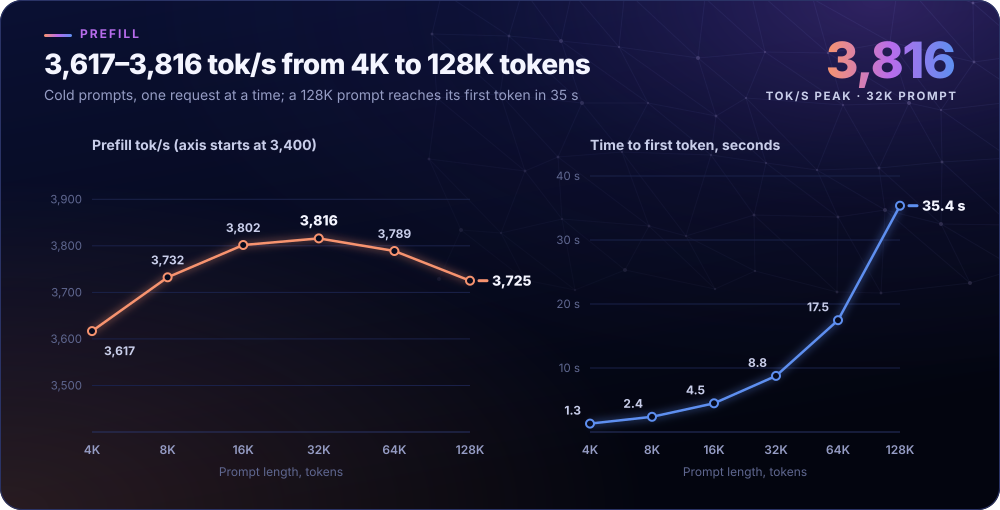
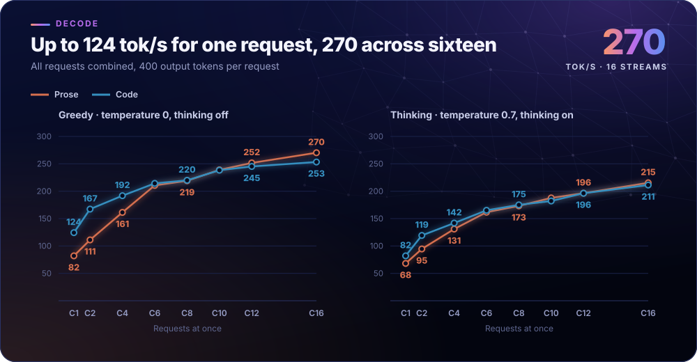
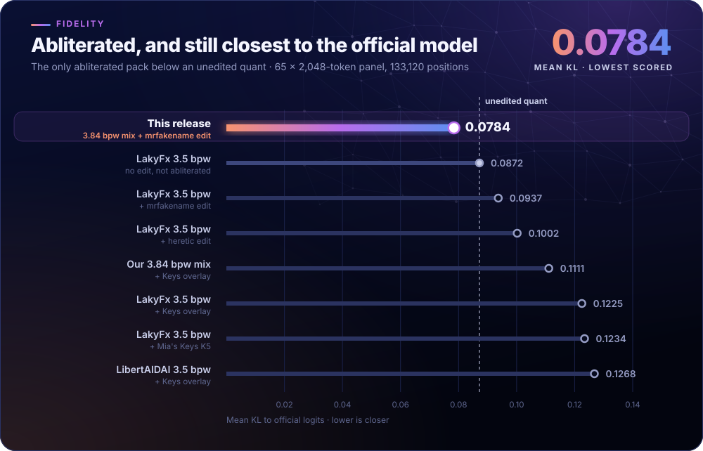
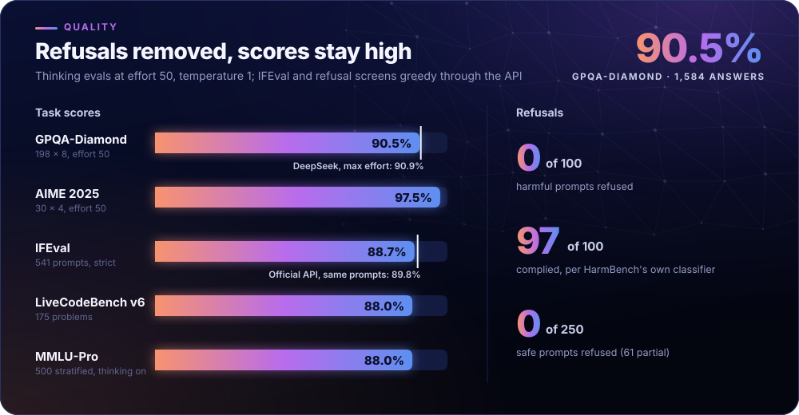
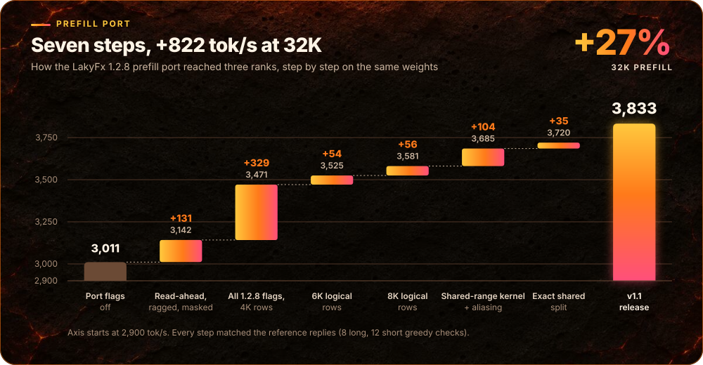

# DeepSeek V4.1 Flash, uncensored, on 3× DGX Spark: 3,816 tok/s prefill, 124 tok/s code decode

Serving recipe for abliterated DeepSeek-V4.1-Flash-1017. **[Weights on Hugging Face](https://huggingface.co/ChimeraWerks/DeepSeek-V4.1-Flash-1017-EXL3-3.84bpw-abliterated)**

<p align="center">
  
</p>

**3× DGX Spark** · TP3 · 3.84 bpw EXL3 · TensorFold `30a9647` · 1M context configured · GPUs capped at 2,300 MHz

<details>
<summary><b>Full specs: v1.2, measured 5 November 2026</b></summary>

| | |
| --- | --- |
| Prefill | **3,816 tok/s** at 32K; holds 3,725–3,816 tok/s from 8K to 128K; a 128K prompt reaches its first token in 35 s |
| Decode | **82 tok/s** prose and **124 tok/s** code at 1 request; **270 tok/s** combined at 16 requests |
| Context | 1,048,576 tokens configured (largest measured prompt 131,088); 8M-token KV pool, 16 streams, 256 GiB NVMe spill |
| Hardware | 3 × DGX Spark (GB10, 128 GB), TP3 with one rank per Spark, every pair cabled directly |
| GPU clocks | Production serves with GPUs capped at 2,300 MHz; set your own with `GPU_CLOCK_CAP_MHZ` |
| Weights | 3.84 bpw EXL3 composition plus [mrfakename](https://huggingface.co/mrfakename/DeepSeek-V4.1-Flash-1017-abliterated)'s rank-2 refusal-removal edit, re-encoded at 6 bits |
| Refusals | 0 of 100 HarmBench prompts refused (98 answered, 2 partial); 0 of 250 XSTest safe prompts fully refused |
| Quality | **97.1%** on the 755-item standard set; **97.5%** AIME 2025; **90.5%** GPQA-Diamond (1,434 of 1,584); 88.7% IFEval; 88.0% LiveCodeBench v6; 88.0% MMLU-Pro (500-item subset) |
| Fidelity | Mean KL **0.0784** and 92.0% top-1 agreement with official logits; the lowest KL of the 8 packs we scored |
| API | `/v1/chat/completions`, `/v1/responses` and `/v1/messages`; tool calls; JSON schemas enforced as the model writes; a [paste-in prompt](#set-up-with-your-coding-agent) lets your coding agent do the setup |
| Engine | TensorFold `dsv41`, production engine `30a9647`, with the LakyFx 1.2.8 prefill port and our TP3 work; the public source rebuilds to the same code we run in production |
| Model | MoE, 384 routed experts, top-6, 1 shared, 40 layers, MLA, DSpark MTP drafter, Engram; `1bae0e1` |

</details>

<p align="center">
  <a href="#performance">Performance</a> ·
  <a href="#dgx-spark-prerequisites">Prerequisites</a> ·
  <a href="#quick-start">Quick start</a> ·
  <a href="#set-up-with-your-coding-agent">Agent setup</a> ·
  <a href="#fidelity-and-quality">Fidelity</a> ·
  <a href="#how-prefill-got-here">Prefill work</a> ·
  <a href="#what-this-build-adds">What this build adds</a> ·
  <a href="#credits">Credits</a>
</p>

## Performance

### Prefill

Every prompt row is split across the three GB10s.

| Prompt | 4K | 8K | 16K | 32K | 64K | 128K |
| --- | ---: | ---: | ---: | ---: | ---: | ---: |
| Prefill tok/s | 3,617 | 3,732 | 3,802 | **3,816** | 3,789 | 3,725 |
| Time to first token | 1.31 s | 2.37 s | 4.49 s | 8.76 s | 17.47 s | 35.36 s |
| Per Spark tok/s | 1,206 | 1,244 | 1,267 | 1,272 | 1,263 | 1,242 |
| Prompt tokens | 4,116 | 8,214 | 16,403 | 32,786 | 65,555 | 131,088 |

<p align="center"></p>

Measured 5 November 2026 on engine `30a9647` with [sparkDash](https://github.com/MiaAI-Lab/sparkDash): cold prompts,
zero cached tokens, one request at a time, three samples through 32K and two at 64K and 128K. tok/s comes from time to
first token with the collector's 171.55 ms request overhead subtracted. All CPU cores, performance cores capped at
3,600 MHz and stock GPU clocks. [Every measured point](benchmarks/v1.2/summary.json).

### Decode

Combined tok/s across all requests at once:

| Requests at once | 1 | 2 | 4 | 8 | 12 | 16 |
| --- | ---: | ---: | ---: | ---: | ---: | ---: |
| Prose, greedy | **82.0** | 111.2 | 161.4 | 219.2 | 251.7 | **270.3** |
| Prose, thinking | 68.1 | 94.6 | 130.9 | 173.3 | 196.5 | 215.4 |
| Code, greedy | **124.4** | 167.2 | 191.9 | 220.0 | 245.2 | 253.4 |
| Code, thinking | 82.0 | 119.3 | 141.9 | 175.1 | 196.3 | 211.3 |

What each request gets, mean tok/s per request:

| Requests at once | 1 | 2 | 4 | 8 | 12 | 16 |
| --- | ---: | ---: | ---: | ---: | ---: | ---: |
| Prose, greedy | **82.0** | 57.2 | 41.0 | 28.1 | 21.7 | 17.5 |
| Prose, thinking | 68.1 | 47.8 | 33.8 | 22.6 | 16.8 | 14.0 |
| Code, greedy | **124.4** | 85.1 | 49.0 | 29.5 | 22.0 | 17.2 |
| Code, thinking | 82.0 | 59.6 | 37.7 | 24.5 | 17.9 | 14.7 |

<p align="center"></p>

Measured 5 November 2026 on engine `30a9647` with a near-empty KV pool: 400 output tokens per request, one run per point,
timed at the engine on short cached prompts, GPUs capped at 2,350 MHz. Greedy is temperature 0 with thinking off; thinking is temperature 0.7 with
thinking on. All 354 decode streams completed with no failures.
C6, C10, structured prompts and every per-stream timing: [v1.2 benchmark record](benchmarks/v1.2/summary.json).

### Clocks

Production serves with GPUs capped at **2,300 MHz**, and the recipe does the same by default. The 3,816 headline is the stock-GPU run; at this cap 32K prefill is 3,711 tok/s, code decode 121.5 tok/s and 16-request prose decode 259.9 tok/s. [Set your own cap](#dgx-spark-prerequisites).

| GPU cap | 32K prefill tok/s | Peak SoC | Peak GPU | Decode GPU power |
| --- | ---: | ---: | ---: | ---: |
| Stock GPU | 3,816 | 94.1 °C | 85 °C | 58.2 W |
| 2,400 MHz | 3,764 | 90.8 °C | 82 °C | 47.2 W |
| 2,350 MHz | 3,734 | 89.7 °C | 81 °C | 43.6 W |
| **2,300 MHz (production)** | 3,711 | 86.2 °C | 78 °C | 40.7 W |

Each row is one full suite on engine `30a9647`, with performance cores capped at 3,300–3,600 MHz.

## DGX Spark prerequisites

| Required | |
| --- | --- |
| Hardware | 3 × DGX Spark (GB10, 128 GB unified memory), every pair cabled directly with one 200 Gb/s QSFP link |
| Network | ConnectX-7 firmware 28.45.4028; RoCEv2, GID index 3; four RDMA devices per node, two logical rails per link; Ethernet MTU 9000, RDMA MTU 4096 |
| OS and drivers | DGX OS 7.6.0 (Ubuntu 24.04.5), NVIDIA 580.178.04 (open), CUDA 13.0, NCCL 2.30.7 |
| Boot flag | `kho=off`, the vendor KHO regression fix that multi-node RDMA on this kernel needs |
| Disk | About 440 GB free per Spark: 274 GB prepared weights, a 93 GB rank file, 68 GB of Engram rows and a 4 GB kernel kit ([runtime assets](docs/runtime-assets.md)); 256 GiB more on the head for spill |
| Access | Key-based SSH from the launch machine to all three Sparks, and from the head to the other two |

These scripts need `cluster.env`; create it first ([Quick start](#quick-start)).

`./scripts/preflight.sh` checks DGX OS, driver, RoCE links, free memory, free disk and SSH on all three and changes
nothing.

**Free more memory.** What our Sparks run, and what each change gives back per node ([development.csv](benchmarks/dev/development.csv)):

| Change | Setting | Frees |
| --- | --- | --- |
| Display Reserved Memory | Auto (`NvidiaDispFrmSizeRequest`); needs the October 2026 firmware: BIOS `5.36_0ACUM028`, SoC/UEFI `0x02009e0f`, EC `0x03000d07`, USB-PD `0x519` | 1,534 MiB (display carveout 2,046 → 512 MiB) |
| 64 KiB-page kernel with UVM packing | `7.0.0-1019-nvidia-64k`, `dgx-spark-memory-saver` 0.4.1 (`ec1b17a`), `uvm_pack=Y` | Together with the firmware: kernel-reserved memory 6.04 → 2.44 GiB, MemTotal 121.7 → 125.3 GiB |
| Memory policy for 64K boots | THP `never`, then `vm.min_free_kbytes=1048576` | The kernel's free-memory reserve drops from about 6.2 GiB to 1 GiB |
| Prompt scratch aliasing | `TF_DS_PROMPT_ALIAS=1` (engine) | 5.44 GB of prompt arena per follower |
| Headless boot | `multi-user.target`, no display manager, sleep targets masked | A few hundred MiB |

**Prepare the Sparks.** One script checks and applies all of this, plus `kho=off` and swap for both page sizes:

```bash
./scripts/prep-sparks.sh status    # each Spark: applied, staged, missing or needs a person; changes nothing
./scripts/prep-sparks.sh apply     # asks per Spark (sudo); stages changes and never reboots
```

Apply, reboot, and repeat until every row reads `applied`. The 64K kernel boots once as a trial before it becomes the
default, and the 4K kernel stays installed. One step needs you at each Spark's console: enrolling the
[memory saver](https://github.com/christopherowen/dgx-spark-memory-saver)'s Secure Boot key; `status` prints how.
`./scripts/prep-sparks.sh explain` lists every item and what it frees.

**Clocks.** `start.sh` caps every Spark's GPU at 2,300 MHz, the cap our production engine serves with: peak SoC temperature
drops from 94.1 to 86.2 °C and decode GPU power from 58 to 41 W, for about 3% less prefill. Set `GPU_CLOCK_CAP_MHZ` in
`cluster.env` to pick your own cap, or `0` for stock clocks. To change it on running Sparks without a restart:

```bash
./scripts/clocks.sh status      # GPU clock on each Spark; changes nothing
./scripts/clocks.sh set 2300    # cap all three Sparks; asks for sudo
./scripts/clocks.sh stock       # back to stock clocks
```

Keep all three Sparks on the same cap: the ranks sync on every layer, so the slowest GPU sets the pace. The cap lasts until
a reboot, and `start.sh` reapplies it. That step needs passwordless sudo for `nvidia-smi`; without it `start.sh` warns and
keeps going, and `clocks.sh set` applies the cap with a prompt ([sudo rule](docs/tuning.md#clocks-and-cpu-placement)).

Each rank also runs a memory guard: it warns below 4 GiB available and stops only its own rank below 2 GiB for 10 s or
below 0.75 GiB for two samples.

## Quick start

Build the engine first with [engine/README.md](engine/README.md). Then, from this repository on a machine that can
SSH to all three Sparks:

```bash
cp cluster.env.example cluster.env && chmod 600 cluster.env   # set SSH names, user, network and paths
```

```bash
./scripts/prep-sparks.sh status   # host setup on each Spark (see above); apply, reboot, repeat
./scripts/preflight.sh     # check all three Sparks; changes nothing
./scripts/prepare.sh       # stage kit and Engram tables, download the weights, build the rank files
./scripts/start.sh         # start the three ranks and the API
./scripts/smoke-test.sh    # one API request
```

`./scripts/status.sh` shows health, units and free memory; `./scripts/stop.sh` stops the API and ranks and keeps weights
and spill. Full steps are in [reproduction](docs/reproduction.md). The API listens on the head's loopback; call it on
the head, or through an SSH tunnel to its port 18002:

```bash
set -a; . ~/ds1017/api/credentials.env; set +a   # on the head: loads SPARK_API_KEY without printing it
curl -s http://127.0.0.1:18002/v1/chat/completions \
  -H "Authorization: Bearer $SPARK_API_KEY" -H "Content-Type: application/json" \
  -d '{"model":"deepseek-v4.1-flash","messages":[{"role":"user","content":"Hello"}]}'
```

The API serves `/v1/chat/completions`, `/v1/responses` and `/v1/messages` with streaming, tool calls and per-request thinking and
effort. Defaults: temperature 1, top_p 1, top_k 20, thinking `high`; request values win. See the
[serving API](serving/README.md).

<details>
<summary><b>Configuration</b></summary>

Settings live in `cluster.env` ([example](cluster.env.example)); release values are checked against the
[release manifest](release/manifest.json) before launch.

| Setting | Default | |
| --- | --- | --- |
| `SPARK_HOSTS` | `spark1 spark2 spark3` | SSH names in rank order, head first |
| `SPARK_USER` / `SSH_KEY` | | SSH user and identity for all three Sparks |
| `MASTER_ADDR` / `NCCL_IB_ADDR_RANGE` | | Head's RoCE address and the RoCE subnet |
| `SPARK_ROOT` | `~/ds1017` | Per-Spark root for weights, ranks, binaries, kit, spill and logs |
| `HF_REPO` / `HF_REVISION` | this release's weights / `2fa62d7` | Weights repository and the tested commit to download |
| `CONTEXT_TOKENS` | 1048576 | One request's positions at most |
| `POOL_TOKENS` | 8000000 | KV positions shared by all requests |
| `STREAMS` | 16 | Requests decoding at once |
| `GRAPH_CAP` | 128 | CUDA graph cache size |
| `GPU_CLOCK_CAP_MHZ` | 2300 | GPU clock cap on every Spark; 0 keeps stock clocks |
| `SPILL_GIB` | 256 | NVMe spill tier on the head |
| `MEMORY_RESERVE_GIB` | 4 | Memory kept free at startup |
| `TOP_K` | 20 | Engine and API sampling top-k |
| `ENGINE_PORT` / `API_PORT` | 8003 / 18002 | Native engine and serving API, both on loopback |
| `SPARK_API_KEY` / `SPARK_ADMIN_KEY` | generated | Client and operator credentials in a mode-0600 file on the head |

Effort names map to numbers (`low` 50, `high` 75, `max` 100) and can be remapped live. See [tuning](docs/tuning.md).

</details>

## Set up with your coding agent

Paste this into a coding agent that has a terminal on the machine that can SSH to your Sparks:

```text
Set up DeepSeek V4.1 Flash on my three DGX Sparks from
https://github.com/ChimeraWerks/DeepSeek-V4.1-Flash-1017-3x-DGX-Spark-TP3-TensorFold-abliterated
with the weights at
https://huggingface.co/ChimeraWerks/DeepSeek-V4.1-Flash-1017-EXL3-3.84bpw-abliterated

1. Clone the repo. Read README.md, docs/reproduction.md and engine/README.md before running anything.
2. Ask me for the three Sparks' SSH names (head first), the SSH user and key, and the head's RoCE address
   and subnet. Write cluster.env from cluster.env.example (chmod 600); keep its HF_REPO and HF_REVISION,
   which pin the tested weights.
3. Run ./scripts/prep-sparks.sh status and explain the result to me. Before each apply, tell me what will
   change. Never reboot a Spark yourself: ask me. Walk me through the memory-saver key enrollment, which
   needs me at each Spark's console. Repeat until every item reads applied.
4. Run ./scripts/preflight.sh and fix what it flags.
5. Build the engine as engine/README.md describes. Install the Hugging Face CLI (hf) on each Spark.
6. Run ./scripts/prepare.sh (it downloads about 344 GB to each Spark), then ./scripts/start.sh and
   ./scripts/smoke-test.sh.
7. Show me the API address and a curl example. Tell me where the API key file is; never print the key.

If a step fails, stop and show me the error. Never skip a check, disable verification or edit the
release manifest to get past one.
```

## Current release: v1.2

v1.2 runs in production on engine `30a9647`, native profile `v1.2`, and the same weights as v1.1. The 5 November suite
measured prefill, decode and the 755-item standard quality set on this engine. The [v1.2 benchmark record](benchmarks/v1.2/summary.json)
keeps all 48 decode points, six cold-prefill points, per-stream timing and the source hashes.

This release adds prefill layer slices so active requests decode between long-prompt chunks, matches more
[`deepseek-recipe`](https://github.com/deepseek-ai/deepseek-recipe) prompt and tool behavior, exposes native Messages routes,
and expires finished vision jobs. Long chat histories now use far less memory when building a prompt, and a returning chat
keeps its saved state while it waits in line, so it no longer recomputes from zero. See the [changelog](CHANGELOG.md) for
the fixes and build verification.

## Fidelity and quality

Refusal-removal edits usually pull a model away from the original: on the LakyFx 3.5 bpw base, every edit we measured raised KL.
This build is abliterated and still the closest to the official model of every pack we scored.

<p align="center"></p>

| Weights | Abliterated | Mean KL ↓ | Top-1 ↑ | p99 KL ↓ | HarmBench answered / partial / refused |
| --- | :-: | ---: | ---: | ---: | --- |
| **This release:** 3.84 bpw + mrfakename edit | yes | **0.0784** | **92.0%** | **1.463** | **98 / 2 / 0** |
| LakyFx 3.5 bpw EXL3, unedited | no | 0.0872 | 91.2% | 1.517 | not run |
| LakyFx 3.5 bpw + mrfakename edit | yes | 0.0937 | 90.8% | 1.620 | 99 / 1 / 0 |
| LakyFx 3.5 bpw + heretic edit | yes | 0.1002 | 90.8% | 1.746 | 93 / 7 / 0 |
| Our 3.84 bpw + Keys overlay | yes | 0.1111 | 90.7% | 1.953 | 95 / 5 / 0 |
| LakyFx 3.5 bpw + Keys overlay | yes | 0.1225 | 89.7% | 2.119 | 93 / 7 / 0 |
| LakyFx 3.5 bpw + Mia's Keys K5 | yes | 0.1234 | 89.6% | 2.097 | not run |
| LibertAIDAI 3.5 bpw + Keys overlay | yes | 0.1268 | 90.1% | 2.031 | 94 / 5 / 1 |

- Lower KL than the unedited 3.5 bpw quant on 59 of 65 cuts (paired mean 0.0088 lower, 95% CI 0.0035 to 0.0131).
- The same mrfakename edit scores 0.0937 on the 3.5 bpw base and 0.0784 on our 3.84 bpw mix.
- Keys overlays cost the most. On the LakyFx base, Mia's Keys K5 added 0.036 KL and the 1017 Keys
  sidecar that Mia's TP4 recipe grafts with `ABLIT=1` added 0.035; mrfakename's edit added 0.0065.

KL is mean per-token KL(official ‖ candidate) against the published official-model logits
([brandonmusic/DeepSeek-V4.1-Flash-1017-Teacher-Logits](https://huggingface.co/brandonmusic/DeepSeek-V4.1-Flash-1017-Teacher-Logits)):
65 cuts of 2,048 tokens, 133,120 positions, balanced across agentic, chat, code, SWE, math, science, legal, multilingual,
long-context, safety and pretraining text. Every row is the full served package on this same panel; KL from other
harnesses (other position sets, or quantized modules swapped into the reference model) is on a different scale. Data:
[fidelity.csv](benchmarks/v1/fidelity.csv).

### Task quality

<p align="center"></p>

| Suite | Setting | Score |
| --- | --- | ---: |
| GPQA-Diamond ([EvalScope](https://github.com/modelscope/evalscope)) | 198 questions × 8 repeats, thinking on (effort 50), temperature 1, top_k 20, 32K cap | **90.5%** (1,434 of 1,584) |
| AIME 2025 | 30 problems × 4 repeats, thinking on (effort 50), temperature 1, 32K cap, rule-checked answers | **97.5%** (117 of 120) |
| IFEval | 541 prompts, greedy, thinking off, 2,048-token cap; prompt-level strict (official API, same settings: 89.8%) | **88.7%** (480 of 541) |
| LiveCodeBench v6 | 175 problems, one pass, thinking on (effort 50), temperature 1, 32K cap | **88.0%** (154 of 175) |
| MMLU-Pro | 500-item stratified subset, thinking on (effort 50), temperature 1, 32K cap | **88.0%** (440 of 500) |

Quality runs used full-vocabulary sampling (top_k 0) except GPQA-Diamond (top_k 20, the serving default). GPQA ran mostly on engine `7d5b4d8` (same greedy replies) and AIME 2025 on `17800d4`; the rest on `14803a3`.

### Refusals: HarmBench and XSTest

| This release | Answered | Partial | Refused |
| --- | ---: | ---: | ---: |
| HarmBench harmful, chat (100) | 98 | 2 | 0 |
| HarmBench harmful, thinking (50) | 18 | 31 | 1 |
| XSTest safe, chat (50) | 49 | 1 | 0 |
| XSTest safe, thinking (25) | 18 | 6 | 1 |

100 HarmBench standard behaviors (stratified, copyright excluded) and 50 XSTest safe prompts, greedy, through the API.
Chat runs thinking off with 768 output tokens (50 of the 100 harmful chat replies reached that cap); thinking runs the first 50 harmful and 25 safe prompts with 3,072
tokens, and 35 of the 50 harmful thinking replies hit that cap, which is where most partials come from. Answers are
graded answered, partial or refused with a fixed rubric plus a keyword screen. Every arm:
[refusal.csv](benchmarks/v1/refusal.csv).

Independent checks on 2 November 2026:

- **HarmBench's own classifier** (`cais/HarmBench-Llama-2-13b-cls`) rates 97 of the same 100 chat answers as complied.
- **All 250 XSTest safe prompts:** 0 fully refused and 61 (24.4%) partially refused, graded by a local
  Qwen2.5-7B-Instruct with the published three-way rubric. 55 of the 61 are nonsense-premise prompts, where
  XSTest's own rubric counts rejecting the premise as compliance; the other seven prompt types had 6 partials in 175.

Data: [quality.csv](benchmarks/v1.1/quality.csv).

## How prefill got here

Every step passed the same parity check: 8 long and 12 short greedy replies matched the reference in text and reasoning. Data: [development.csv](benchmarks/dev/development.csv).

| Engine | Change | 4K | 8K | 16K | 32K |
| --- | --- | ---: | ---: | ---: | ---: |
| `ee903f5` | Starting point: 2,447–2,480 tok/s across 4K–32K | | | | |
| `7dd3526` | Owned-row prefill: each rank computes its third of the prompt rows | 2,935 | 3,010 | 3,027 | 3,023 |
| `46ae23c` | Owned rows extended to more projections and the compressor | 2,983 | 3,083 | 3,066 | 3,055 |
| `93d0b4c` | Direct all-gathers into place | 3,043 | 3,111 | 3,103 | 3,077 |
| `14803a3` | v1.1: 1.2.8 port, 8K-row windows, shared-expert split, prompt aliasing | **3,560** | **3,708** | **3,811** | **3,833** |

<p align="center"></p>

<details>
<summary><b>The 1.2.8 port step by step (32K)</b></summary>

An engineering progression, not isolated A/B tests: KV pool sizes changed between steps (10M early, 8M at the end).

| Step | 32K tok/s |
| --- | ---: |
| Port flags off, matched baseline | 3,011 |
| Engram read-ahead, ragged experts and masked attention (`AE`, `W`, `K`) | 3,142 |
| All 1.2.8 flags, 4K logical rows, 2,048-row physical GEMMs for exact output | 3,471 |
| 6K logical rows | 3,525 |
| 8K logical rows | 3,581 |
| Ragged expert kernel on the shared range, plus prompt aliasing | 3,685 |
| Exact shared-expert partition (`c60fe1b`) | 3,720 |
| v1.1 release suite (`14803a3`, all cores) | **3,833** |

</details>

<details>
<summary><b>Every prefill flag and what it does</b></summary>

| Piece | Flag | Origin | What it does |
| --- | --- | --- | --- |
| Owned-row prefill | `TF_DS_PREFILL_OWNED` | ChimeraWerks | Each rank computes a third of the prompt rows and shares owner rows with rank-ordered FP32 accumulation (+20–22%) |
| Direct all-gathers | `TF_DS_DIRECT_GATHER` | ChimeraWerks | Owned rows gather straight into their destination (+0.7–2.0%) |
| Shared-expert split | `TF_DS_PREFILL_SHARED_SPLIT` | ChimeraWerks | Exact bitmap partition of shared-expert prompt work across ranks |
| Prompt scratch aliasing | `TF_DS_PROMPT_ALIAS` | ChimeraWerks | Prefill buffers share memory: each follower's prompt arena shrinks by 5.44 GB |
| 8K logical windows | `TF_DS_PREFILL_AC`, `TF_DS_PREFILL_COMPUTE_ROWS=8192` | LakyFx flag, ChimeraWerks window | 8,192-row prompt chunks with physical GEMMs kept in 2,048-row slices so output stays exact |
| Owned work in more ops | `TF_DS_PREFILL_D` / `E` / `F` | LakyFx 1.2.8 | Extends per-rank row ownership |
| Masked attention | `TF_DS_PREFILL_K` | LakyFx 1.2.8 | Prompt attention skips masked blocks |
| Ragged expert kernel | `TF_DS_PREFILL_W` | LakyFx 1.2.8 | Expert GEMMs over ragged token groups |
| Engram read-ahead | `TF_DS_PREFILL_AE` | LakyFx 1.2.8 | Reads the next chunk's Engram rows while the current chunk computes |
| Bounded scratch | `TF_DS_PREFILL_AF` | LakyFx 1.2.8 | Bounds prompt scratch memory |
| Layer slices (v1.2, not in the v1.1 steps above) | `TF_DS_PREFILL_SLICE=5` | ChimeraWerks, after Mia's patch 0052 | A prompt chunk runs five layers at a time, with a decode round between slices |

</details>

## Repeated and shared prompts

- **NVMe spill.** Prompt states pushed out of the 3 GiB in-memory cache go to a 256 GiB disk tier on the head. A
  13,908-token prompt took 4.47 s cold, **61 ms** when resent after 480 other prompts had evicted it, and 1.41 s after
  an engine restart. With spill on, replies matched 12/12 and 32K prefill measured 3,713 tok/s.
- **Prefix wait.** Requests that share a long prefix wait for the in-flight prefill instead of recomputing it: eight
  requests on a new 17K prompt went from 65.7 s to 14.2 s for the last first token.

Data: [development.csv](benchmarks/dev/development.csv).

## How TP3 splits the model

One TensorFold rank per GB10. Every layer's attention heads, expert channels and vocabulary are split three ways: 64
attention heads are padded to 72 so each rank gets 24, and the vocabulary is padded from 129,280 to 129,408 so each rank
holds 43,136 slots. Padded heads contribute nothing and padded token IDs are masked for both target and draft sampling.
Each rank file is about 93 GB, so the model needs three 128 GB nodes. The Sparks are cabled pairwise over RoCE
([topology](docs/topology.md)); the head (rank 0) also runs the API, the sampler and the spill tier.

## What this build adds

Everything here is on in v1.2, on top of the TensorFold `dsv41` baseline. The changes in the first two tables each passed the same
greedy parity check when they were added, and their measured effects come from v1.1 or earlier. Most public
DeepSeek-V4.1-Flash Spark recipes target two or four nodes; the patches in the second table were written for those and
ported to three ranks here.

**Built for this release** ([development.csv](benchmarks/dev/development.csv))

| Change | Measured effect |
| --- | --- |
| 3.84 bpw weight composition with the mrfakename edit | Mean KL 0.0784, the lowest of every pack we scored, with 0 of 100 HarmBench prompts refused |
| Owned-row prefill and direct gathers | +20–22%, then +0.7–2% prefill |
| Shared-expert split, 8K windows, prompt aliasing | Same greedy replies; the exact partition adds +2.6% at 4K; aliasing frees 5.44 GB of prompt arena per follower |
| Graph-capture fallback (`14803a3`) | Every C16 stream completes with the ragged expert kernel on; the previous build's C16 run did not finish |
| Qualify once (`9011df3`) | Expert-range checks run 4 times instead of 1,040; the first 4K prompt no longer takes 12.4 s |
| Cross-rank CUDA graph vote | Ranks agree before recording and first launch; injected capture faults stop all ranks in 9–10 s instead of hanging |
| Lifecycle scripts and memory guards | Preflight, prepare, start, smoke test, status and stop for three nodes; a per-rank memory guard |

**Ported to TP3**

| Change | Flag | From | Measured effect |
| --- | --- | --- | --- |
| NVMe spill tier | `TF_DS_SPILL_GIB=256` | Mia's TP2 recipe (wojo, BadAd84) | 61 ms instead of 4.47 s for an evicted 13,908-token prompt |
| GPU top-k sampling | `TF_DS_SAMPLE_CAND=1`, top_k 20 | Mia's TP4 recipe | Sampled requests pick from the top 20 tokens on the GPU instead of scanning the 129K vocabulary on the CPU: sampled 16-stream decode 184 → 193–196 tok/s (+5–7%) |
| Prefix wait | on | TensorFold | Eight requests on a new 17K prompt: last first token 65.7 s → 14.2 s |
| Prefill/decode interleave | `TF_DS_PREFILL_YIELD=1` | Mia's TP2 recipe (Coinupbtc) | Running streams keep decoding between a long prompt's chunks |
| RDMA idle backoff | `TF_RDMA_IDLE_S=2`, `TF_RDMA_NAP_US=500` | willjriley, Mykhailo Tamarin | Busiest idle thread 100% of a core → 0.3–0.5%; hottest SoC zones 8–12 °C cooler |
| Engram read-failure exit | on | Mia's TP4 recipe (hecisaza) | A failed Engram read stops the whole group instead of leaving partial ranks |
| Peer watch | `TF_DS_PEER_STALL_SECONDS=120` | wojo's failure exit | A follower exits cleanly when the lead rank's link drops; a killed or rebooted follower recovered in 7.3–7.5 min |
| Adaptive speculation and prompt caches | `TF_DS_ADAPTIVE_LEARNING=1`, `TF_CACHE_*`, `TF_KV_*` | LakyFx | 3 GiB prompt cache with prefix retention; replies 12/12 identical |

**New in v1.2** (details in the [changelog](CHANGELOG.md))

| Change | Flag | From |
| --- | --- | --- |
| Prefill layer slices: running streams decode between slices of a long prompt chunk | `TF_DS_PREFILL_SLICE=5` | ChimeraWerks, after Mia's patch 0052 (lukaszraczylo) |
| Prompt rendering, Responses reasoning and tools, tool history checks and strict schemas | on | Behavior matched to [`deepseek-recipe`](https://github.com/deepseek-ai/deepseek-recipe) 0.2.0 |
| Think and DSML markers matched by token, not spelling | on | Behavior matched to `deepseek-recipe` |
| Replayed `reasoning` field, GET and DELETE body handling, and two lane fixes | on | Mia's patches 0047 and 0046, TensorFold `ed39acc5`, Mia PR 94 review |

The engine also carries several ported features that stay off in production. [engine/README.md](engine/README.md) lists them.

<details>
<summary><b>Tried and dropped</b></summary>

Measured on the Sparks and left out because they lost speed or headroom ([development.csv](benchmarks/dev/development.csv)):

| Arm | Result |
| --- | --- |
| 16K logical prefill windows | No gain; rank 0 down to 5.5 GiB available |
| Two-window prefill pipeline | Never paired: memory admission refused long prompts at 8M and 6M pools |
| Dense GEMM kits stages2 / stages3 | −6% / −2% at 32K |
| Attention warps8 kit | −6.2% at 32K |
| Persist16 / Live16 kernel variants | −2.8% / −2.4% at 32K |
| Indexer column split | −1.7% prefill |
| Host-staged RDMA | About −15% |
| Step-ahead | A cold short request after a reply waited 1.17–1.21 s instead of 0.41–0.48 s |
| 6-bit or replacement (D1) draft model | Up to 5% slower / no consistent gain; the native 4-bit DSpark drafter stays |
| NCCL CTA counts 4, 8, 16 | Within noise; the recipe keeps 8 |

</details>

## Repository layout

```
scripts/          prep-sparks, preflight, prepare, start, smoke-test, status, stop, clocks
engine/           TensorFold dsv41 source at 30a9647, build script and kernel inputs
serving/          OpenAI-compatible serving API
tools/            Spark host prep, cluster deployer, rank preparation and release checks
release/          manifest, historical manifests, runtime asset pins, weight provenance, build hashes
benchmarks/       v1.2, v1.1 and v1 speed, fidelity, refusal and quality data
docs/             reproduction, topology, tuning, troubleshooting, model card
```

## Credits

- **[DeepSeek](https://huggingface.co/deepseek-ai/DeepSeek-V4.1-Flash-1017)**: the model (MIT).
- **[TensorFold](https://github.com/ashhart/TensorFold)** by Ash Hart, with
  **[BertholomusAI](https://github.com/bertholomus/TensorFold)**'s `dsv41` DeepSeek-V4.1 family: the engine.
- **[LakyFx](https://github.com/LakyFx/deepseek-v41-flash-exl3-tp3-spark)**: TP3 layout and export, prompt caches,
  adaptive speculation, the 1.2.8 prefill work and imported serving files.
- **[Mia's AI Lab](https://github.com/MiaAI-Lab)** and its patch authors: the TP2/TP4 patches ported here, and
  [sparkDash](https://github.com/MiaAI-Lab/sparkDash), which measured every speed number.
- **Weights:** [easthambuilds](https://huggingface.co/easthambuilds/DeepSeek-V4.1-Flash-1017-EXL3-3.75bpw),
  [LibertAIDAI](https://huggingface.co/LibertAIDAI/DeepSeek-V4.1-Flash-1017-EXL3-3.5bpw),
  [bertholomus](https://huggingface.co/bertholomus/DeepSeek-V4.1-Flash-1017-EXL3-4.0bpw) and
  [LakyFx](https://huggingface.co/LakyFx/DeepSeek-V4.1-Flash-1017-EXL3-3.5bpw-TensorFold) (EXL3 tensors),
  **[mrfakename](https://huggingface.co/mrfakename/DeepSeek-V4.1-Flash-1017-abliterated)** (refusal-removal edit),
  [turboderp](https://github.com/turboderp-org/exllamav3) (EXL3).
- **Evaluation:** [brandonmusic](https://huggingface.co/brandonmusic/DeepSeek-V4.1-Flash-1017-Teacher-Logits)
  (official-model logits), [EvalScope](https://github.com/modelscope/evalscope),
  [HarmBench](https://github.com/centerforaisafety/HarmBench), [XSTest](https://github.com/paul-rottger/xstest).

Revisions and every patch author: [CREDITS.md](CREDITS.md).

## License

Repository code: Apache License 2.0 ([LICENSE](LICENSE)). Weights: MIT, following DeepSeek. Third-party components keep their own licenses ([NOTICE](NOTICE),
[THIRD_PARTY_NOTICES.md](THIRD_PARTY_NOTICES.md)).
